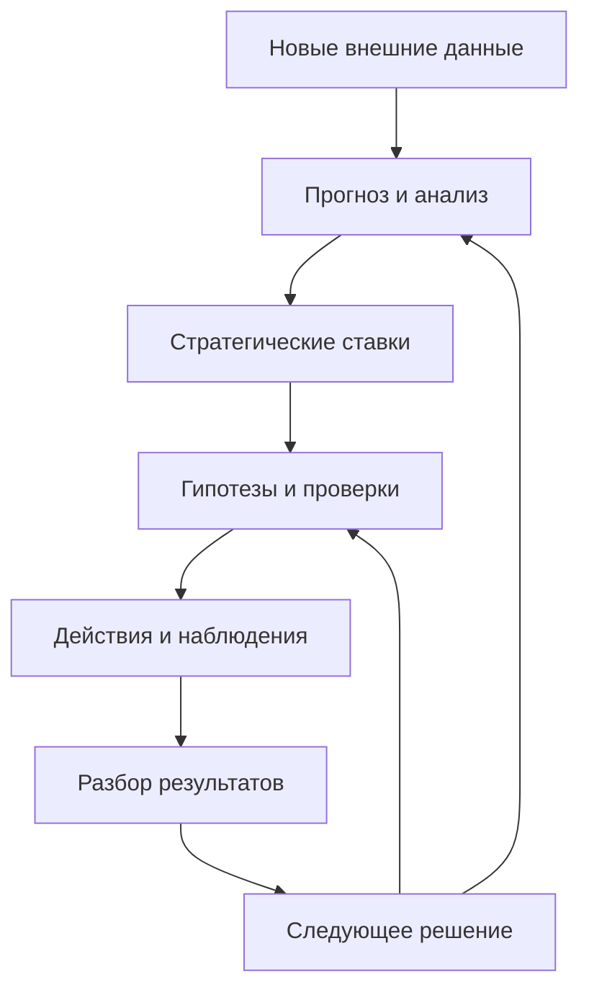

# Обратная связь между анализом и проверкой стратегии

[База знаний](README.md) → [Реализация стратегии](implementation.md) → Анализ и проверка стратегии

Как возвращать изменения внешней среды и результаты проверки гипотез в прогноз, анализ и следующие решения?

Эта методическая практика замыкает контур подготовки и реализации. Она сохраняет [стандарт Карты гипотез](standard.md#1.2): факторы и стратегические ставки относятся к анализу, а не добавляются как новые обязательные элементы нотации КГ. Практику можно применять в бизнесе, общественных проектах, личной и семейной стратегии.

## Содержание

- [Два направления обратной связи](#loop)
- [Какие связи и основания сохранять](#traceability)
- [Алгоритм пересмотра](#review)
- [Сигнал для решения](#signal)
- [Регулярная проверка с ИИ](#agent)
- [Личная и семейная стратегия](#personal)
- [Результат работы](#output)

## <a id="loop"></a> Два направления обратной связи

Первое направление начинается с внешнего события: изменился фактор, поэтому нужно проверить основанные на нём ставки и гипотезы. Второе начинается с собственного действия: проверка дала результат, который уточняет представление о людях, системе, доступных возможностях или ограничениях.



Это схема управленческого цикла. Причинная логика внутри гипотезы по-прежнему раскрывается через «если — то — потому что — тогда», Субъект и его мотивацию либо прямой эффект в бессубъектном контуре.

## <a id="traceability"></a> Какие связи и основания сохранять

Для каждой используемой стратегической ставки сохраните путь до конкретных гипотез, метрик и результатов:

| Связь | Что она означает | Что нужно уметь найти |
| --- | --- | --- |
| Фактор → ставка | Фактор участвует в обосновании ставки | Источник, дата, версия фактора и смысл зависимости |
| Ставка → гипотеза | Гипотеза раскрывает способ реализации ставки | Идентификаторы обоих элементов и объяснение переноса |
| Гипотеза → Субъект → метрика цели | Ожидается изменение самостоятельного поведения | Мотивация, «то» и причинный переход «тогда» |
| Гипотеза → метрика цели напрямую | Ожидается эффект в системе или процессе | Прямой механизм без придуманного Субъекта |
| Гипотеза → действия → наблюдения | Создаётся и выполняется проверка | Версия гипотезы, экспозиция, фактический ресурс, окно и данные |
| Наблюдения → вывод → анализ | Результат уточняет исходные представления | Что изменилось в знаниях, в каком контексте и какое решение принято |

Ссылка на фактор показывает происхождение рассуждения, но не доказывает причинность. Цель задаёт смысл метрик; она не является физическим событием, которое само вызывает изменение числа. Цепочку удобно читать в обе стороны: от основания к результату и от изменившейся метрики к зависимым предположениям.

В [Связанном SWOT](https://github.com/Byndyusoft/linkedswot) учитываются внутренние сильные и слабые стороны, внешние тренды и угрозы. Вопрос «какая возможность появилась?» помогает найти новую ставку на их сочетании. Само предложенное действие не записывают как внешний фактор. У обоснованной ставки должны быть реальные связи с внутренними и внешними основаниями; их нельзя придумывать ради формального заполнения.

Сохраняйте все существенные зависимости, включая отношения многие ко многим. Изменение одного фактора может затронуть несколько ставок; одна гипотеза может опираться на несколько оснований. Отсутствие связи — пробел модели, а не доказательство отсутствия влияния.

Для ручной работы достаточно таблицы соответствий и устойчивых ссылок. В Социотехе используйте штатную структурную связь между ставкой и гипотезой через доступную MCP-операцию; совпадающее название или текстовая заметка её не заменяют. Если операция или данные недоступны, обозначьте связь как неподтверждённую в инструменте.

## <a id="review"></a> Алгоритм пересмотра

### 1. Зафиксируйте рамку проверки

Назовите проект, объект анализа, горизонт, версии анализа и карты, источники и дату последней успешной проверки. Выберите, кто принимает решения и какие изменения уже разрешены агенту. Согласуйте события для внепланового разбора: нарушение границы, потеря ключевой предпосылки, неожиданный эффект или существенное изменение ресурса.

### 2. Сравните данные с предыдущим состоянием

Для внешних факторов проверьте новые возможности, усиление угроз и потерю актуальности прежних условий. Для каждого существенного изменения сохраните источник, дату события, дату наблюдения и отличие от прошлой версии. Отделите факт от прогноза, экспертного суждения и предложения ИИ.

Одновременно прочитайте результаты проверок, временные ряды, фактические действия и расход ресурса. Отсутствие доступа или свежих данных отметьте как пробел. Оно не означает, что мир не изменился. Истечение срока актуальности источника также не доказывает ложность фактора — оно требует повторной проверки.

### 3. Найдите затронутые зависимости

Пройдите от изменившегося фактора к связанным ставкам и гипотезам, затем к условиям механизма, субъектам, метрикам и действиям. Проверьте, не появилась ли новая значимая зависимость, которой раньше не было в модели.

Для каждой затронутой ветки ответьте:

1. Сохраняется ли исходное основание ставки?
2. Какое условие механизма стало сомнительным или перестало выполняться?
3. Меняются ли [потенциал эффекта, неопределённость или стоимость проверки](hypothesiseffect.md)?
4. Остаётся ли цель значимой, а её цена допустимой?
5. Требуется ли решение сейчас или достаточно следующей плановой каденции?

Не переводите любой новый факт в автоматическую смену приоритета. Назовите конкретную зависимость и основание влияния. Большое число ссылок также не доказывает высокую ценность гипотезы.

### 4. Верните результаты проверки в анализ

Разберите возможные объяснения результата:

| Что выяснилось | Куда вернуть вывод |
| --- | --- |
| Действие не выполнено или нужная группа не получила воздействие | В задачи, ресурс и дизайн проверки; механизм пока может оставаться непроверенным |
| Данные не позволяют различить эффект | В измерение и следующее наблюдение; не объявлять гипотезу ложной |
| Механизм не сработал в наблюдавшихся условиях | В гипотезу, её границы и связанные допущения |
| Изменилась внешняя предпосылка | В прогноз, фактор и все существенно зависимые ставки |
| Обнаружена собственная возможность или ограничение | Во внутренний анализ с указанием данных и контекста |
| Показатель изменился под влиянием нескольких причин | В причинный разбор; не приписывать весь эффект выбранной гипотезе |

Неудачная гипотеза не опровергает автоматически все связанные факторы. Удачная проверка не подтверждает весь прогноз. Вывод должен оставаться в пределах полученных свидетельств.

### 5. Примите решение и сохраните историю

Возможные решения: сохранить ветку, уточнить основание или механизм, изменить проверку, пересмотреть ресурс, приостановить, закрыть либо вернуться к цели и анализу. Зафиксируйте автора решения, основание, затронутые версии, следующий шаг и срок или событие возврата.

Перед записью проверьте, не изменились ли элементы с момента чтения. Если изменилась значимая предпосылка, сначала пересмотрите предложение по актуальным данным. После записи перечитайте связи, метрики и задачи. Не оставляйте активные действия на закрытой ветке без объяснения и не стирайте отрицательные результаты.

## <a id="signal"></a> Сигнал для решения

Полезный сигнал показывает, что именно требует внимания:

```text
Проект, период и версии:
Что изменилось: было → стало:
Источник, дата события и дата проверки:
Затронутые факторы, ставки, гипотезы и метрики:
Какая зависимость может нарушиться и почему:
Что известно, что предполагается, каких данных нет:
Варианты решения и цена отсрочки:
Кто рассматривает сигнал и когда:
Статус: новый / рассматривается / решение принято / наблюдение продолжается:
```

Это служебная запись, не новый элемент нотации. Повторные сигналы по одному изменению объединяют, сохраняя новые свидетельства. Сообщение «появилась новость на рынке» без связи со ставкой ещё не является основанием корректировки стратегии.

## <a id="agent"></a> Регулярная проверка с ИИ

Для старта можно выбрать ежемесячный обзор внешних факторов и внеплановый разбор критичных событий. Реальный ритм зависит от изменчивости среды и цены задержки. Контроль опасной балансирующей границы не должен ждать ежемесячного обзора.

Две точки входа:

- [Подключение агента к Социотеху через MCP](https://sociotech.center/mcp).
- [Скиллы для Связанного SWOT, Карты гипотез и проектных операций](https://github.com/Byndyusoft/sociotech-ai-skills).

Скилл задаёт способ работы, MCP даёт доступ к поддерживаемым операциям. Расписание, источники и доставка уведомлений настраиваются отдельно в используемой среде. Наличие скилла само по себе не означает непрерывного мониторинга или отправки сообщений. Не объявляйте отсутствующую интеграцию действующей; используйте явный экспорт или ручной запуск, если это согласовано.

Шаблон задания для настройки регулярного обзора:

> Раз в месяц проверь согласованные источники для указанного проекта, начиная с последней успешной проверки. Сопоставь внешние факторы с их прежними версиями, а результаты наших проверок — с исходными предположениями. Покажи затронутые ставки, гипотезы и метрики по существующим связям; отсутствующие связи обозначь пробелами. Подготовь сигналы с источниками и вариантами решения. Отдельно перечисли недоступные данные и отсутствие существенных изменений. Не подменяй гипотезу фактом. Изменения целей, приоритетов и ресурса вынеси на решение уполномоченного человека. Доставь результат только по заранее согласованному каналу и получателю.

Перед запуском вместо общего описания задают конкретные идентификаторы, источники, расписание, разрешения и канал. Сначала выполняют один ручной обзор и проверяют полезность результата. Технический сбой отмечают отдельно от успешного обзора без существенных изменений. Следующий запуск охватывает пропущенный период и не создаёт дубли решений.

ИИ помогает находить расхождения и готовить варианты. Смысл зависимости, причинный вывод и решение о допустимой цене требуют человеческого рассмотрения. Протокол доступа и записи — в [модели данных](datamodel.md#безопасный-рабочий-цикл-агента).

## <a id="personal"></a> Личная и семейная стратегия

В личной карте внешними данными могут быть условия обучения, расписание доступных занятий или требования к выбранной деятельности. Внутренние возможности и ограничения обновляются по собственным наблюдениям; не подменяйте их диагнозами ИИ.

Учебный пример: мастерская перенесла занятия на рабочие вечера. Изменился внешний фактор доступности, поэтому прежняя ветка организации творческой практики требует пересмотра. Это не означает, что человек утратил интерес к творчеству. Можно проверить другой способ организации занятий и отдельно наблюдать влияние на верхнюю метрику удовлетворённости.

Для семьи перечень данных и видимость сигналов согласуются участниками. Изменение расписания одного человека не создаёт обязанности другого принять его нагрузку. Сохраняйте отдельные границы, право на личные ветки и [два уровня карты](personalstrategy.md#два-уровня-личной-карты).

## <a id="output"></a> Результат работы

На выходе должны быть проверяемые изменения анализа, список затронутых зависимостей и принятые решения либо вопросы с ответственными. Допустим и результат «существенных изменений по проверенным источникам нет», если видны охват и пробелы.

Качество цикла определяется тем, удаётся ли вовремя замечать изменение оснований и корректировать действия. Число уведомлений и автоматических запусков само по себе не показывает полезность.

Связанные разделы: [связь с другими методами](methodologylinks.md#связанный-swot-анализ), [метрики и доказательства](metrics.md), [связь с операционкой](strategyoperations.md), [подготовка с ИИ](stratsession.md#ai-month), [потенциал гипотезы](hypothesiseffect.md).
